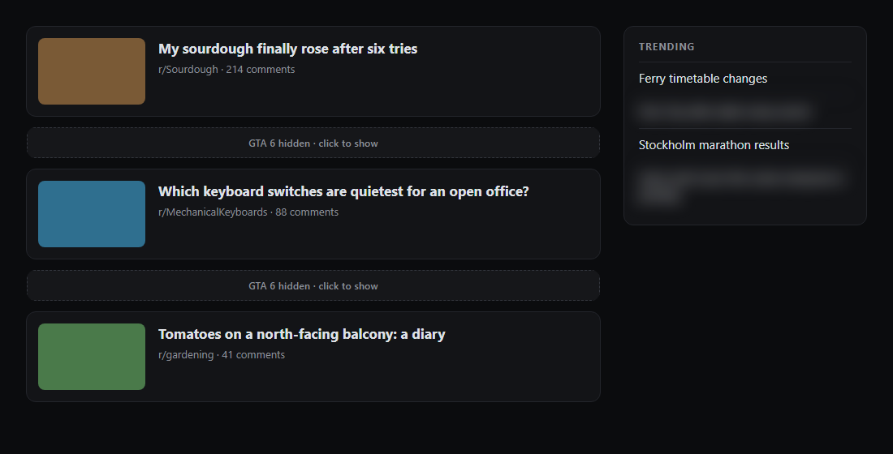

# GTA 6 Spoiler Shield

GTA 6 is out on console. The PC version is not, and I am waiting for it. This is an adblocker where the ad is GTA 6: posts, videos, comments and whole pages that mention the game are hidden before they are drawn on screen.

> **This project is AI-generated.** All of the code, the tests, this documentation, the icon and the demo image were written by Claude Fable 5.2 (an AI model from Anthropic) in Claude Code. A human gave the directions and tried the result in their own browser. Nobody has audited it. It is short enough to read before you install it, and you should.

It runs as a browser extension in Chrome and Edge, and as a userscript in Firefox on desktop and Android.

## What you see

- On Reddit, YouTube, Instagram and X, a post, video tile or comment about the game collapses into a bar. The thumbnail goes with it. Click the bar if you decide you want to see it.
- On every other site, the matching headline or paragraph is blurred, together with the picture next to it.
- If the page itself is about the game (a GTA video, a GTA subreddit, a search for it), the whole page is covered and any video is paused. You get "Go back" and "Show anyway".
- Hard mode removes "click to show" and "Show anyway", for when you do not trust yourself.

## Install

### Chrome, Edge, Brave

1. Download this repository (green **Code** button, then **Download ZIP**) and unzip it.
2. Open `chrome://extensions` (or `edge://extensions`) and switch on **Developer mode**.
3. Click **Load unpacked** and choose the `extension` folder.

### Firefox, desktop and Android

Firefox only installs extensions that Mozilla has signed, so here it runs as a userscript.

1. Install [Violentmonkey](https://addons.mozilla.org/firefox/addon/violentmonkey/).
2. Open [gta6-spoiler-shield.user.js](https://raw.githubusercontent.com/KarlssonChristoffer/gta6-spoiler-shield/main/dist/gta6-spoiler-shield.user.js) and click **Install**.

Settings are in the Violentmonkey menu: click its toolbar icon while on any page. Tampermonkey should work the same way but has not been tested.

## Settings

| Setting | What it does |
|---|---|
| Shield on | The master switch. |
| Pause on this site | Leaves one site alone, for example a forum where you want to read a GTA V thread. |
| Hard mode | Hidden things cannot be revealed. |
| Extra words | Your own words to hide, one per line. Add another game, a character, a streamer. |

## How it works

1. **It reads what the page says.** Text, image descriptions and link addresses. Not the pixels of pictures or the sound of videos.
2. **It compares that with a word list.** "GTA 6", "GTA VI", "Grand Theft Auto", "Vice City", the names from the official trailers, and so on. Spelling tricks such as `#GTAVI`, `gta_6` or `G.T.A. 6` are flattened first. Common words like "Jason" only count when two of them appear together.
3. **It hides the whole item, not the word.** On the sites it knows, it finds the post or video tile the text belongs to and collapses that. Elsewhere it blurs the smallest block that looks like one item.
4. **It does this before the browser paints.** New content is checked the instant the page adds it, so hidden posts do not flash while you scroll.

The longer version, for people who want to change the code, is in [docs/ARCHITECTURE.md](docs/ARCHITECTURE.md).

## What it cannot do

No list of words catches everything. Know the gaps before you trust it:

- **Pictures and video with an innocent title.** A thumbnail or meme captioned "no way" gets through. So does a Short or Reel with no caption.
- **Phone apps.** The Reddit, YouTube and Instagram apps cannot be touched by an extension. On Android, use those sites in Firefox with the userscript.
- **Sound.** If a video starts before the page title has loaded, you may hear a second of it.
- **Friends.** Group chats are on you.

It will also hide things that are not spoilers: every older GTA game, and the Greater Toronto Area. That is deliberate. Use "Pause on this site" or remove a word in `extension/src/keywords.js`.

## Privacy

The code makes no network requests and collects nothing. Settings stay in your browser. Browsers will warn that it can "read and change data on all websites": that is true and unavoidable, because spoilers can be on any website. The whole thing is about 600 lines, in `extension/src/`, with no dependencies and no minified code.

## Block GTA sites on your whole network

If you run [Pi-hole](https://pi-hole.net), [pihole/regex-denylist.txt](pihole/regex-denylist.txt) blocks the dedicated GTA fan sites and wikis for every device at home. It cannot filter inside Reddit or YouTube: Pi-hole sees site names, not posts.

## Use it for another game

Everything specific to GTA 6 is in one file, [extension/src/keywords.js](extension/src/keywords.js). Change the label and the word lists, and you have a shield for something else.

## Contributing

Sites rename their page elements a few times a year, so the usual bug is "this slipped through on site X", and the usual fix is one line in [extension/src/sites.js](extension/src/sites.js). [CONTRIBUTING.md](CONTRIBUTING.md) shows how, including how to add a test by writing one line of HTML.

One rule: **no spoilers in issues, pull requests, tests or code.** Describe where something slipped through, not what it said.

## Who made this

An AI did. Claude Fable 5.2 wrote every file in this repository over one evening, including the commit messages, issue templates and this README. The human part was the idea, the directions, and checking that it works in Firefox. The demo image is a screenshot of a made-up page, also written by the AI; it does not show a real website.

Not affiliated with or endorsed by Rockstar Games or Take-Two Interactive. Grand Theft Auto is their trademark.

[MIT License](LICENSE)
